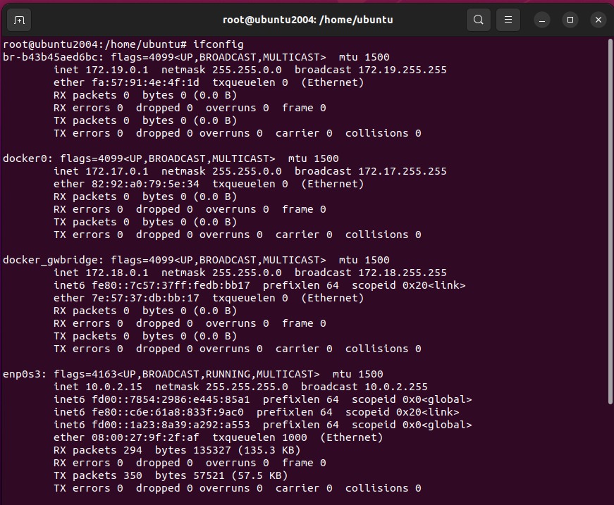
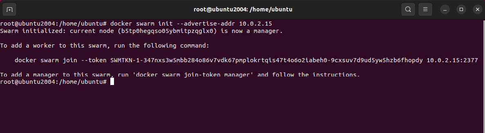
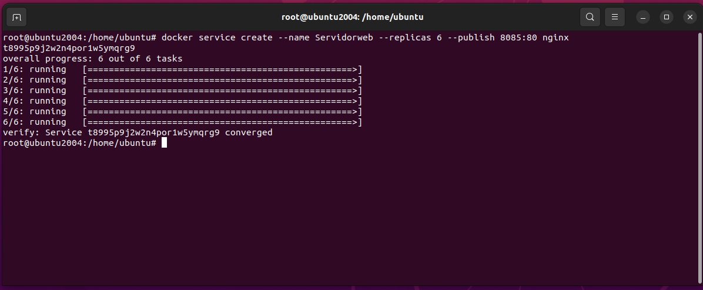
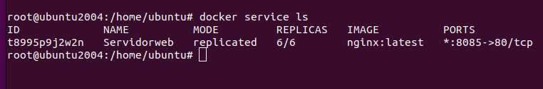
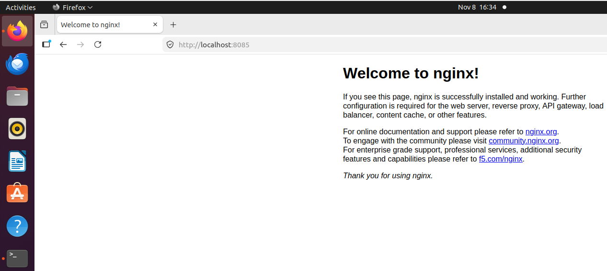
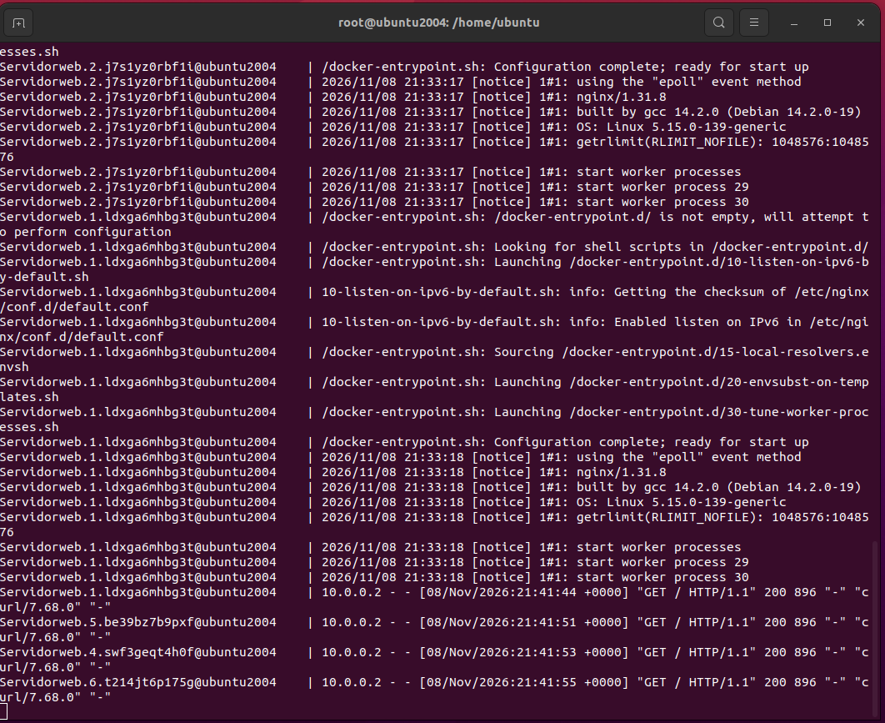
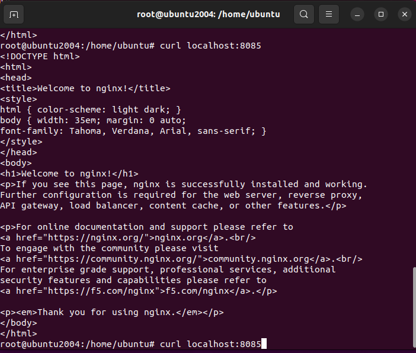

# 🐝Ejemplo 04: Docker Swarm y Escalabilidad

En el ejemplo se vera la administración y escalado de clústeres de contenedores con **Docker Swarm**.

## 🚀 1. Administración Básica del Clúster Swarm

### Paso 1.1: Verificar Disponibilidad del Comando
Antes de iniciar, verificamos que Docker Swarm está disponible en el sistema.

```bash
docker swarm
```
* **Explicación**: Despliega las opciones del subcomando `swarm` (`init`, `join`, etc.).

### Paso 1.2: Obtener la Dirección IP del Nodo
Identificamos la IP de la interfaz de red principal donde escuchará el clúster (en entornos **Linux/Ubuntu**).

```bash
ifconfig
```

<div align="center">
  
  <br>
  <sub><b>Figura 1:</b> Comando ifconfig linux.</sub>
  <br>
</div>

Identificamos la IP de la interfaz de red principal donde escuchará el clúster (en entornos **Windows**).

```bash
ipconfig
```

* **Explicación**: Permite ubicar la IP (ej. `10.0.2.15` en la interfaz `enp0s3`) que usaremos para que otros nodos se conecten.

### Paso 1.3: Inicializar el Clúster Swarm (Nodo Manager)
Para convertir la máquina actual en el nodo administrador (**Manager Leader**):

```bash
docker swarm init --advertise-addr 10.0.2.15
```
<div align="center">
  
  <br>
  <sub><b>Figura 2:</b> Iniciamos docker swarm.</sub>
  <br>
</div>


* **`docker swarm init`**: Activa el modo Swarm en el motor Docker local.
* **`--advertise-addr`**: Especifica la dirección IP que los demás nodos (workers) usarán para comunicarse con este nodo administrador.
* **Resultado**: Se genera un **token de unión** único (`SWMTKN-1-...`).

### Paso 1.4: Obtener Token para Nodos Trabajadores (Workers)
Si necesitas agregar más máquinas al clúster en el futuro como nodos de trabajo:

```bash
docker swarm join-token worker
```
* **Explicación**: Imprime la instrucción exacta y el token de seguridad que se debe ejecutar en los nodos secundarios para sumarse al enjambre.

### Paso 1.5: Listar Nodos del Clúster
Para verificar qué máquinas forman parte del clúster actual:

```bash
docker node ls
```
* **Explicación**: Muestra el ID, nombre de host, estado (`Ready`), disponibilidad (`Active`) y rol del nodo (`Leader` para el Manager principal).

### Paso 1.6: Desactivar o Abandonar el Clúster
Si deseas desmontar el nodo o salir del clúster:

```bash
docker swarm leave --force
```
* **Explicación**: Fuerza al nodo actual a abandonar el clúster Swarm.

---

## 📈 2. Creación y Escalabilidad de Servicios

### Paso 2.1: Desplegar un Servicio Publicando Puertos
Para exponer el servicio al exterior mapeando puertos:

```bash
docker service create --name Servidorweb --replicas 6 --publish 8085:80 nginx
```

<div align="center">
  
  <br>
  <sub><b>Figura 4:</b> Creación de las Replicas Servidor Web.</sub>
  <br>
</div>

* **`--replicas 6`**: Levanta 6 instancias/contenedores idénticos distribuidos en el clúster.
* **`--publish 8085:80`**: Asigna el puerto `8085` de la máquina al puerto `80` interno de NGINX.
* **Balanceo Ingress**: Cualquier petición entrante al puerto `8085` será distribuida automáticamente entre las 6 réplicas.

### Paso 2.2: Inspeccionar Servicios y Logs
Para verificar el estado global de los servicios activos:

```bash
docker service ls
```

<div align="center">
  
  <br>
  <sub><b>Figura 5:</b>Mostrando las Replicas del Servidor Web.</sub>
  <br>
</div>

* **Explicación**: Muestra el total de réplicas en ejecución (ejemplo: `6/6`).

<div align="center">
  
  <br>
  <sub><b>Figura 6:</b>Mostrando las Replicas del Servidor Web.</sub>
  <br>
</div>

Para ver en tiempo real el tráfico y logs unificados de todas las réplicas:

```bash
docker service logs Servidorweb -f
```

<div align="center">
  
  <br>
  <sub><b>Figura 7:</b>Log en tiempo real.</sub>
  <br>
</div>

* **`-f` *(Follow)***: Mantiene la salida abierta escuchando nuevas peticiones enviadas al balanceador.

### Paso 2.3: Probar el Balanceo de Carga con `curl`
Ejecutando peticiones repetidas al puerto expuesto:

```bash
curl localhost:8085
```

<div align="center">
  
  <br>
  <sub><b>Figura 8:</b>Comando curl en acción.</sub>
  <br>
</div>

* **Explicación**: Al revisar los logs (`docker service logs`), se observará cómo diferentes contenedores (`Servidorweb.1`, `Servidorweb.2`, ..., `Servidorweb.6`) atienden las solicitudes de manera alternada.

### Paso 2.4: Escalar la Aplicación Dinámicamente
Si la demanda aumenta, podemos escalar de 6 a 12 réplicas sin tiempo de parada (*zero downtime*):

```bash
docker service scale Servidorweb=12
```
O para el servicio de Tomcat:

```bash
docker service scale my-web-service=3
```
* **Explicación**: Swarm creará o destruirá contenedores automáticamente hasta alcanzar el número deseado en el estado meta.

Para reducir el número de réplicas:

```bash
docker service scale my-web-service=2
```

### Paso 2.5: Inspeccionar las Tareas Internas de un Servicio

```bash
docker service ps my-web-service
```
* **Explicación**: Detalla el nodo donde se está ejecutando cada contenedor específico de ese servicio y su estado actual (`Running`).

### Paso 2.6: Eliminar un Servicio

```bash
docker service rm Servidorweb
```
* **Explicación**: Elimina el servicio y detiene de inmediato todas sus réplicas activas.

