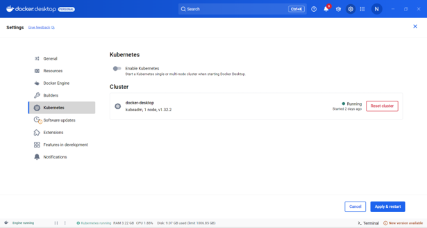
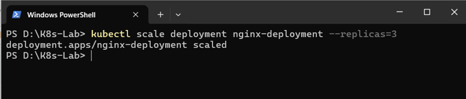
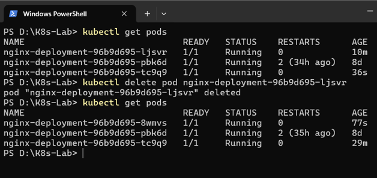

# ☸️ Kubernetes con Docker Desktop y `kubectl`

Documentación detallada paso a paso para la creación de: manifiestos YAML, comandos de verificación, escalabilidad, auto-reparación.

---

## 🚀 Actividad 1: Configuración del Entorno de Kubernetes

### Paso 1.1: Habilitar Kubernetes en Docker Desktop
1. Abrir la interfaz gráfica de **Docker Desktop**.
2. Dirigirse a la sección de **Settings** (ícono de engranaje en la parte superior derecha).
3. Seleccionar **Kubernetes** en el menú lateral izquierdo.
4. Marcar la casilla **Enable Kubernetes**.
5. Hacer clic en el botón **Apply & Restart**.
6. Confirmar la instalación y esperar a que el indicador en la esquina inferior izquierda pase a estado verde (`Kubernetes is running`).

---

<div align="center">
  
  <br>
  <sub><b>Figura 09:</b> Docker Desktop en Kubernetes.</sub>
 <br>
</div>


### Paso 1.2: Verificación del Contexto y del Clúster

#### 1. Consultar y cambiar el contexto activo:
Abre tu terminal (PowerShell o CMD) y ejecuta:

```powershell
kubectl config get-contexts
```

Si el asterisco (`*`) no apunta a `docker-desktop`, cambia el contexto ejecutando:

```powershell
kubectl config use-context docker-desktop
```

#### 2. Verificar el estado del clúster y del nodo:
Ejecuta los comandos para comprobar la conexión con el Control Plane:

```powershell
kubectl cluster-info
kubectl get nodes
```

* **Resultado esperado**: 
  * `Kubernetes control plane is running at https://kubernetes.docker.internal:6443`
  * Un nodo llamado `docker-desktop` con estado `Ready` y rol `control-plane`.

---

## 📄 Actividad 2: Creación de Deployment y Service con YAML

### Paso 2.1: Despliegue de NGINX (`nginx-deployment.yaml`)

1. Crea la carpeta de trabajo `k8s-lab` y navega hacia ella:
   ```powershell
   mkdir k8s-lab
   cd k8s-lab
   ```

2. Crea el archivo `nginx-deployment.yaml`:

```yaml
apiVersion: apps/v1
kind: Deployment
metadata:
  name: nginx-deployment
  labels:
    app: nginx
spec:
  replicas: 1
  selector:
    matchLabels:
      app: nginx
  template:
    metadata:
      labels:
        app: nginx
    spec:
      containers:
      - name: nginx
        image: nginx:latest
        ports:
        - containerPort: 80
```

3. Aplicar el manifiesto en el clúster:
   ```powershell
   kubectl apply -f nginx-deployment.yaml
   ```

4. Verificar el despliegue:
   ```powershell
   kubectl get deployments
   kubectl get pods
   kubectl describe deployment nginx-deployment
   ```

---

### Paso 2.2: Exposición del Servicio NGINX (`nginx-service.yaml`)

1. Crea el archivo `nginx-service.yaml` en la misma carpeta:

```yaml
apiVersion: v1
kind: Service
metadata:
  name: nginx-service
spec:
  type: NodePort
  selector:
    app: nginx
  ports:
    - protocol: TCP
      port: 80
      targetPort: 80
      nodePort: 30080
```

2. Aplicar el servicio:
   ```powershell
   kubectl apply -f nginx-service.yaml
   ```

3. Verificar el estado del servicio:
   ```powershell
   kubectl get services
   ```

4. **Prueba de acceso**: Abre un navegador web e ingresa a:
   `http://localhost:30080` (debe mostrar la pantalla de bienvenida de NGINX).

---

## 📈 Actividad 3: Escalabilidad y Auto-reparación

### Paso 3.1: Escalar el Deployment de NGINX
Incrementa las réplicas del deployment a 3 desde la terminal:

```powershell
kubectl scale deployment nginx-deployment --replicas=3
```

<div align="center">
  
  <br>
  <sub><b>Figura 10:</b> Escalado en Kubernetes.</sub>
 <br>
</div>


Verifica la creación de las 3 réplicas:

```powershell
kubectl get pods
```

---

### Paso 3.2: Demostrar Auto-reparación (*Self-Healing*)
1. Lista los Pods para copiar el nombre exacto de uno de ellos:
   ```powershell
   kubectl get pods
   ```
2. Elimina manualmente un Pod (por ejemplo `nginx-deployment-96b9d695-ljsvr`):
   ```powershell
   kubectl delete pod nginx-deployment-96b9d695-ljsvr
   ```
3. Ejecuta inmediatamente el comando de verificación:
   ```powershell
   kubectl get pods
   ```
* **Observación**: Notarás que el Pod eliminado ya no está, pero Kubernetes creó uno nuevo de forma automática en pocos segundos para mantener la regla declarada de 3 réplicas.


<div align="center">
  
  <br>
  <sub><b>Figura 11:</b> Auto-reparado kubernetes.</sub>
 <br>
</div>

---

### Paso 3.3: Limpieza de Recursos
Elimina los manifiestos creados para liberar memoria y recursos del equipo:

```powershell
kubectl delete -f nginx-service.yaml
kubectl delete -f nginx-deployment.yaml
```

---

